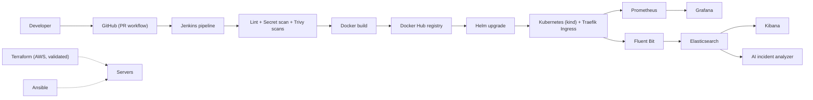

# AI-Powered E-Commerce DevOps & Cloud-Native Delivery Platform

A production-style DevOps platform built around an existing static e-commerce
application (Nexvion). The focus is the automated, secure, observable delivery
ecosystem around the application, not the application itself.

## Architecture



## Technology stack

| Area | Technology |
|---|---|
| OS and automation | Linux (Ubuntu on WSL2), Bash scripts |
| Source control | Git, GitHub (feature branches, PRs, protected main) |
| Containers | Docker, Docker Compose, non-root Nginx image |
| CI/CD | Jenkins (Jenkinsfile), Docker Hub |
| Infrastructure as Code | Terraform (AWS VPC, security group, EC2) |
| Configuration management | Ansible (roles: common, docker, app) |
| Orchestration | Kubernetes (kind), Helm, Traefik Ingress |
| Monitoring | Prometheus, Grafana, nginx-prometheus-exporter |
| Logging | Elasticsearch, Kibana, Fluent Bit (EFK) |
| DevSecOps | Gitleaks, Trivy (fs, config, image), Hadolint, Pod Security `restricted` |
| AI | Log/incident analyzer (rule-based, optional LLM summary) |

## Repository layout

| Folder | Purpose |
|---|---|
| `application/` | Nexvion static e-commerce frontend |
| `scripts/` | setup, deploy, health-check, backup, cleanup, port-forward |
| `docker/` | Dockerfile, Nginx config (with `/health`), docker-compose |
| `jenkins/` | Jenkinsfile (CI/CD pipeline) |
| `terraform/` | AWS infrastructure code |
| `ansible/` | Inventory, playbook, roles |
| `kubernetes/` | Raw manifests (reference) and kind cluster config |
| `helm/ecommerce/` | Helm chart (the deployment method used by Jenkins) |
| `monitoring/` | Prometheus values, Grafana dashboard export |
| `logging/elk/` | Elasticsearch, Kibana, Fluent Bit configuration |
| `security/` | Scan script, reports, hardening notes |
| `ai/incident-analysis/` | Incident analyzer and sample logs |
| `docs/` | Architecture, implementation, deployment, troubleshooting |

## Quick start (local)

```bash
./scripts/setup.sh          # check required tools
./scripts/deploy.sh         # build and run with Docker Compose
./scripts/health-check.sh   # http://localhost:8082/health
```

Full Kubernetes deployment: see [docs/deployment.md](docs/deployment.md).

## What was verified

- CI/CD: Jenkins pipeline runs end to end (lint, secret scan, dependency/config scan,
  build, image scan, push, Helm deploy, health check).
- Kubernetes: rolling updates, scaling, Helm upgrade and rollback demonstrated.
- Observability: Prometheus scrapes the app; Grafana dashboards show pod CPU/memory
  and Nginx request metrics; Kibana searches centralized logs.
- Security: pod security `restricted` enforced (non-compliant pod rejected),
  non-root containers, branch protection on `main`.
- AI: analyzer classifies logs, scores severity and suggests root cause and remediation.

## Limitations (honest scope)

- **Cloud deployment:** Terraform for AWS is written and passes `terraform validate`,
  but was **not applied** (no cloud account available). The platform runs on a local
  kind cluster; the same Helm chart and pipeline target a cloud cluster unchanged.
- **Ansible** was tested against a local Ubuntu container acting as the server; the
  Docker installation tasks are written for real servers and skipped in the container.
- **Deployment strategies:** rolling updates are demonstrated; blue-green and canary are not.
- **Security scans are report-only** (`--exit-code 0`). The image scan reports HIGH/CRITICAL
  OS-package findings in the Alpine base image; production would fail the build on them
  and pin a patched base image.
- **Elasticsearch and Grafana** use lab settings (security disabled / default password).
  Production needs TLS, authentication and secrets management.
- The AI analyzer is rule-based by default; the LLM summary mode needs an API key.
- The Kubernetes Secret in the repo is a demo placeholder, never a real secret.
